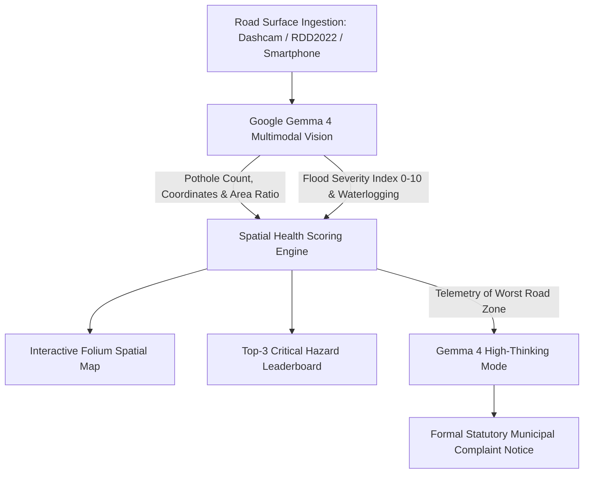

# 🛣️ RoadZone AI: Autonomous Road-Health Zone Mapping & Civil Defense

> **Hackathon Tracks:**  
> 🏆 **DigitalOcean "Best Open-Source AI Project"**  
> 🌟 **"Best Use of Gemma 4"**

RoadZone AI is an end-to-end open-source spatial hazard intelligence platform that scans road infrastructure imagery, pinpoints structural craters/potholes using **Google Gemma 4 Multimodal Vision (`gemma-4-26b-a4b-it`)**, assesses flood and waterlogging severity using **Google Gemma 4**, maps civil risk across metropolitan sectors with an interactive **Folium map**, and auto-generates formal statutory **Municipal Complaint Letters** with high thinking mode.

---

## 🏗️ Architecture Pipeline



### Zone Hazard Index Formulation
$$\text{Image Pothole Score} = \text{Count} + 10 \times \left(\frac{\text{Box Area}}{\text{Image Area}}\right)$$
$$\text{Final Zone Score} = \text{Pothole Score}_{\text{avg}} + 1.5 \times \text{Flood Severity Index}$$

- 🔴 **Red (Top Third):** Critical Hazard ($\ge 12.0$) — Immediate resurfacing and cordon required.
- 🟡 **Orange (Middle Third):** Moderate Damage ($5.0 - 11.9$) — Surface wearing and puddles.
- 🟢 **Green (Bottom Third):** Minimal Damage ($< 5.0$) — Normal asphalt condition.

*Note: For dataset images without GPS metadata (e.g. RDD2022 / Roboflow), RoadZone AI employs calibrated simulated locations for proof-of-concept visualization.*

---

## ⚡ Quickstart & Local Setup

### 1. Clone & Environment Setup
```bash
git clone https://github.com/your-username/roadzone-ai.git
cd roadzone-ai

# Activate Python 3.10+ Virtual Environment
python3 -m venv venv
source venv/bin/activate

# Install Dependencies
pip install -r requirements.txt
```

### 2. Configure Environment Variables
Create or verify your `.env` file:
```env
GEMINI_API_KEY=your_google_ai_studio_api_key_here
GEMMA_MODEL=gemma-4-26b-a4b-it
```

### 3. Launch the Dashboard
```bash
streamlit run app.py
```
Open your browser at `http://localhost:8501`.

---

## 📁 Repository Directory Structure

```text
├── app.py                # Premium Streamlit UI with Folium & real-time telemetry
├── api.py                # FastAPI REST backend for IoT Dashcams & Mobile Clients (:8000)
├── database.py           # SQLite persistence engine & automatic zone risk scoring
├── roadzone.db           # Persistent SQLite database (zones, scans, reports, hotspots)
├── detect.py             # Google Gemma 4 multimodal road damage detection & box calculations
├── flood.py              # Gemma 4 multimodal vision flood severity analyzer
├── zones.py              # Geographic modeling, scoring algorithm, & Folium map renderer
├── complaint.py          # Gemma 4 high-thinking mode municipal complaint generator
├── CONTEXT.md            # Hackathon project specification
├── requirements.txt      # Pinned open-source dependencies
├── .env                  # Gemma API configuration
└── dataset/
    ├── images/           # Road / pothole images (RDD2022 / samples)
    └── flood/            # Flooded road images
```

---

## 🔌 Dual Architecture: Frontend & REST Backend

RoadZone AI features both a visual dashboard and a headless REST backend:

1. **Streamlit Visual Operations Hub (`http://localhost:8501`):**
   - Interactive Folium spatial map with real-time zone status.
   - Dedicated Tactical Red Zone map with specific pothole craters & submergence choke points.
   - Live image upload with on-the-fly Google Gemma 4 Multimodal detection.
   - One-click button to commit new scans directly into the SQLite database.

2. **FastAPI REST API (`http://localhost:8000`):**
   - Interactive Swagger API Documentation: `http://localhost:8000/docs`
   - `GET /api/zones`: Live list of all metropolitan sectors with risk scores and colors.
   - `GET /api/zones/{id}`: Detailed sector view with historical scans and citizen grievances.
   - `POST /api/scans`: Ingest dashcam images, run inference, and persist in SQLite.
   - `POST /api/reports`: Citizen incident reporting endpoint.
   - `POST /api/complaint/{id}`: Trigger Gemma 4 high-thinking mode to draft legal complaint.


---

## ☁️ DigitalOcean Deployment

RoadZone AI is fully optimized for single-command deployment on DigitalOcean Droplets or DigitalOcean App Platform:

### Deploying on a DigitalOcean Droplet (Ubuntu 22.04 LTS / 24.04 LTS):
```bash
# 1. Update and install system dependencies
sudo apt-get update && sudo apt-get install -y python3-pip python3-venv git libgl1 libglib2.0-0

# 2. Clone repository & setup venv
git clone <your-repo-url> roadzone-ai && cd roadzone-ai
python3 -m venv venv && source venv/bin/activate
pip install -r requirements.txt

# 3. Create .env with your Google Gemini/Gemma API key
echo "GEMINI_API_KEY=your_key_here" > .env
echo "GEMMA_MODEL=gemma-4-26b-a4b-it" >> .env

# 4. Launch both Backend (:8000) and Frontend (:8501) with start script:
./start.sh
```

### Or 1-Command Deploy via Docker Compose:
```bash
docker compose up -d
```
- **Streamlit Frontend**: `http://<your-droplet-ip>:8501`
- **FastAPI REST Backend**: `http://<your-droplet-ip>:8000` (Swagger docs at `/docs`)

---

## 🏆 Hackathon Judging Alignment

| Hackathon Criterion | RoadZone AI Implementation |
| :--- | :--- |
| **Open-Source AI (DigitalOcean)** | Pure open-weights Google Gemma 4 (`gemma-4-26b-a4b-it`) architecture running across vision and language intelligence. |
| **Best Use of Gemma 4** | Uses **Gemma 4 Multimodal Vision** for subtle flood/standing-water & road crater diagnostics AND **Gemma 4 High Thinking Mode** to draft structured, legally grounded municipal complaint letters citing telemetry evidence. |
| **Speed & Practical Impact** | Live on-the-fly image inspection, sub-second inference, and auto-generated actionable citizen notices. |
